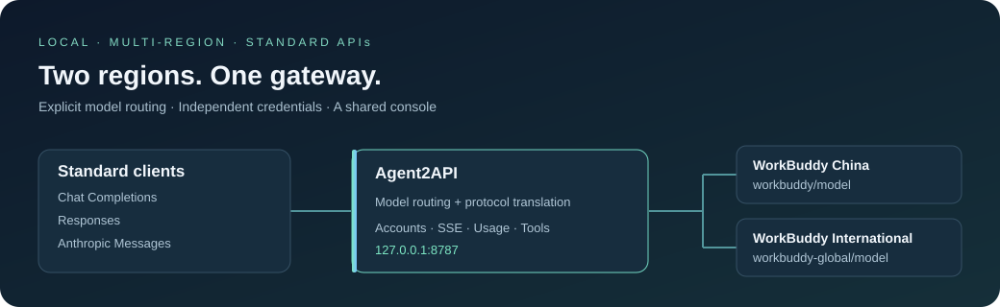

# Agent2API

**One local gateway for multiple AI platforms, with standard LLM APIs.**

Platform adapters connect upstream services to shared Chat Completions, Responses and Anthropic Messages endpoints, routing, streaming and a management console. **Currently implemented: WorkBuddy / CodeBuddy China, WorkBuddy International, free OpenRouter models and Cursor Free allowance.**

[](https://github.com/576469377/Agent2API/actions/workflows/ci.yml)
[](go.mod)

[简体中文](README.md) · **English** · [Quick start](docs/quickstart.md) · [Platforms](docs/platforms.md) · [Documentation](docs/README.md) · [Changelog](CHANGELOG.md) · [Issues](https://github.com/576469377/Agent2API/issues)



> [!IMPORTANT]
> A personal learning and research project, for your own authorized accounts on your machine or a controlled private environment. Private upstream protocols may change, and this usage may conflict with upstream terms. Read the [disclaimer](DISCLAIMER.md); do not offer a public service or publish credentials. No license has been selected.

## What it does

Connect Claude Code, ZCode, Codex CLI and other compatible clients to one local endpoint. Each adapter handles its upstream protocol while clients keep using standard APIs. New platforms reuse the existing protocol layers, routing and console.

| Capability | Available today |
|---|---|
| APIs | Chat Completions, Responses, Anthropic Messages; streaming and non-streaming |
| Routing | Platform prefixes, aliases, optional same-name fallback before stream acceptance |
| Accounts | WorkBuddy region isolation, credential discovery and refresh, pools, affinity, optional concurrency limits |
| Conversations | Text, image input, reasoning and native tool calls; model capabilities vary |
| Management | Nine-page console, interactive trends, usage analytics, combined log filters, account tables, client setup, English / Chinese and themes |
| Extension | Platform adapters reuse shared routing, protocol layers and the console |

## Choose an upstream

| Platform ID | Authentication | Scope and limits |
|---|---|---|
| `workbuddy` | China desktop login or console device authorization | Account pools; model availability and credit rates follow the catalogue, paid requests remain possible |
| `workbuddy-global` | International desktop login or console device authorization | Independent region and pool; encrypted desktop credentials verified on Windows |
| `openrouter` | Your own `OPENROUTER_API_KEY` | Live free catalogue; paid and unknown-price models rejected; no WorkBuddy pool |
| `cursor` | Personal Free desktop login under the same OS user | Only `cursor/composer-2.5`; entitlement checks before each generation; no images or sampling parameters |

**Starting without a config enables only the two WorkBuddy regions. [config.example.json](config.example.json) enables all four platforms.** Keep the platforms you need and load it explicitly with `-config config.json`. API compatibility does not imply identical upstream capabilities. See [platform support and limits](docs/platforms.md) (Chinese).

## Quick start

Install **Go 1.23+**. These commands build the current default branch and start WorkBuddy without a config file. Reuse an authorized desktop login or sign in through the console. Other platforms have their own setup steps in the [quick-start guide](docs/quickstart.md).

```powershell
# Windows PowerShell
git clone https://github.com/576469377/Agent2API.git
cd Agent2API
go build -trimpath -o bin/agent2api.exe ./cmd/agent2api
./bin/agent2api.exe
```

```bash
# macOS / Linux
git clone https://github.com/576469377/Agent2API.git
cd Agent2API
go build -trimpath -o bin/agent2api ./cmd/agent2api
./bin/agent2api
```

Open **[http://127.0.0.1:8787](http://127.0.0.1:8787)**. Confirm the platform and its authentication method on Platforms, complete sign-in or key setup, copy a complete model ID from Models, then verify a reply in the playground.

- Default startup keeps both regions available. Platforms without usable credentials show “Sign in needed” and accept a first account through the console.
- Select China with `-platform workbuddy`, or International with `-platform workbuddy-global`.
- Without a desktop login, open Accounts → Add account and choose China or Global; the `login -region cn/global` command also works.
- International encrypted desktop credentials are verified on Windows. Their macOS / Linux path has not yet been verified end to end; see the [integration report](docs/research/04-WorkBuddy国际版接入.md).
- International chat requests include the required conversation headers and preserve a stable conversation ID across turns. This fixes `11128 / request illegal` when the same account still works in the official client; the error alone does not establish an account ban. See [troubleshooting](docs/troubleshooting.md).
- Requests share an attempt budget and routing deadline across accounts and platforms. Explicit account concurrency limits use a bounded queue; the console shows live phases, queue time and individual attempts. See [configuration](docs/configuration.md#请求预算和等待队列gateway) and the [stability review](docs/reviews/2026-10-23-gateway-stability-review.md).

The detailed [quick-start guide](docs/quickstart.md) is in Chinese; commands and flags work in either language.

## Client connections

Clients use gateway port **8787**. The separate console's default port **8788** is a management entry point.

| Client / protocol | Address | Model |
|---|---|---|
| Chat Completions | Base URL: `http://127.0.0.1:8787/v1` | Copy from the catalog |
| Responses | `POST http://127.0.0.1:8787/v1/responses` | Copy from the catalog |
| Claude Code | `ANTHROPIC_BASE_URL=http://127.0.0.1:8787` | Aliases can map client model names |
| ZCode | Anthropic Messages; Base URL: `http://127.0.0.1:8787/v1` | Prefer `platform/model` IDs |

Without a gateway key, authentication is disabled; use `agent2api-local` if a client requires a value. With a gateway key configured, every client must use that same key. Keep default content sanitization enabled for client integration.

Sync confirmed free models from connected platforms into one ZCode provider. Paid, dynamic, unknown and unavailable entries are removed; retained free models keep their preferences and ordering. A removed default is replaced with an enabled free model. Start the gateway and prepare a local config first:

```powershell
Copy-Item config.example.json config.json  # First setup only; preserve an existing config
python scripts/sync-zcode.py --config config.json --dry-run
python scripts/sync-zcode.py --config config.json
```

See the [client guide](docs/clients.md) for authentication, requests, backups and recovery.

## Models and routing

| Requested model ID | Routing |
|---|---|
| `workbuddy/model` | Pins China |
| `workbuddy-global/model` | Pins International |
| `cursor/composer-2.5` | Personal Cursor Free allowance; signed-in desktop installation required |
| `openrouter/author/model:free` | Pins a free OpenRouter model; copy the exact catalogue ID |
| Bare model name | First matching platform in configuration order |
| Configured alias | Maps to a real model, optionally pinning a platform |

`models.fallback_on_unavailable` defaults to `false`. When enabled, bare IDs may try the same model on another platform after quota, rate-limit or HTTP 5xx refusals before a stream is accepted. Qualified IDs and platform-pinned aliases stay in their region. An accepted stream never switches platforms.

The catalog is account-dependent. **Catalog support, scheduling readiness and remaining quota are separate facts.** A listed model may still fail to generate. See the [configuration guide](docs/configuration.md).

## Web console

Overview, request logs, usage analytics, accounts, platforms, models, playground, client setup and settings share data from configured platforms. Interactive trends, diagnostics and cumulative rankings link to filtered logs. WorkBuddy supports account sign-in and pool management; OpenRouter and Cursor use their own setup methods. Copy real gateway endpoints and request examples for all three protocols.

The UI is embedded in the gateway; no frontend build is required. A standalone console can load updated assets **without restarting a gateway in use or changing client endpoints**. See the [console guide](docs/console.md). Ordinary pages use local resources; math loads KaTeX on demand and falls back to source text offline.

## Documentation

Detailed guides are currently in Chinese, with copyable commands, field names and examples.

| Task | Guide |
|---|---|
| Install, log in, start and verify | [Quick start](docs/quickstart.md) |
| Compare platform authentication, capabilities and limits | [Platforms](docs/platforms.md) |
| Connect ZCode or other clients | [Clients](docs/clients.md) |
| Configure regions, prefixes, aliases and fallback | [Configuration](docs/configuration.md) |
| Manage accounts, cooldowns and concurrency | [Accounts](docs/accounts.md) |
| Use or update the UI | [Console](docs/console.md) |
| Inspect endpoints, auth and request examples | [API](docs/api.md) |
| Diagnose keys, models, quota and login | [Troubleshooting](docs/troubleshooting.md) |
| Understand or contribute to the code | [Architecture](docs/architecture.md) · [Contributing](CONTRIBUTING.md) |

The [documentation index](docs/README.md) separates historical designs from protocol research and dated verification reports.

## Configuration

See the [configuration guide](docs/configuration.md) for CLI flags, environment variables, JSON, multi-platform examples, aliases, concurrency and Prometheus. Start with [config.example.json](config.example.json), remove platforms you do not need and load it explicitly.

## Multi-account pools

WorkBuddy pools schedule your authorized accounts by health, with affinity, optional concurrency limits and model cooldowns. Concurrency is unlimited by default. Keep the regions in separate credential directories. OpenRouter and Cursor do not use this pool. See [Accounts](docs/accounts.md).

## Supported APIs

Generation endpoints are `/v1/chat/completions`, `/v1/responses` and `/v1/messages`, with `/v1/models`, `/health` and `/metrics` alongside them. See the [API guide](docs/api.md).

## Security

Credentials grant account access. Do not publish local config, account files, ZCode configuration or runtime metrics. Remove keys, nicknames and upstream request IDs from reports. The gateway binds to `127.0.0.1` by default; expanded network access requires an API key and access controls. See [SECURITY.md](SECURITY.md).

## Architecture

Protocol codecs communicate with upstream adapters through a dependency-free IR. The Hub routes between WorkBuddy's regional pools and independently authenticated OpenRouter / Cursor adapters. See the [current architecture](docs/architecture.md); original design proposals remain in the documentation index.

## Known Limitations

- Private upstream interfaces have no stability promise; models and quota depend on the upstream and account.
- Non-streaming responses aggregate an upstream stream. This gateway does not implement the full OpenAI / Anthropic product API.
- Balance queries are not implemented; a schedulable account may have no usable quota.
- Cooldowns, affinity and concurrency slots are process-local; instances do not share state.
- Reasoning has no upstream signature. Text-mode DSML tool-call fallback is not implemented.
- International encrypted desktop credentials have only been verified end to end on Windows.
- Cursor retains native Agent rules and receives client system instructions as context. Images, sampling, effort, JSON output mode and stop parameters are unsupported. Output budgets are enforced by the gateway; see [platform limits](docs/platforms.md).

## Testing

```bash
go test ./...
go vet ./...
node --test scripts/test-console-*.mjs
python -m unittest discover -s scripts -p 'test_*.py'
```

Tests use offline fixtures and mock services rather than consuming real model quota. Frontend tests need Node.js; ZCode and diagnostic tooling need Python 3.9+. Ordinary gateway builds need neither runtime; Cursor credential reading on macOS / Linux requires Python 3. See [Contributing](CONTRIBUTING.md) for race detection and development workflows.

## FAQ

See [Troubleshooting](docs/troubleshooting.md) for keys, model collisions, quota, regional credentials and ZCode configuration loading.

## Roadmap

- [x] Unified China / International management, qualified IDs and same-name fallback
- [x] Redesigned console and standalone UI without gateway restarts
- [x] Incremental ZCode model sync preserving preferences
- [x] Account pools, concurrency limits, model aliases and Prometheus metrics
- [x] Free-only OpenRouter models and Cursor Composer 2.5 Free allowance
- [ ] macOS / Linux verification of international encrypted credentials
- [ ] Additional upstream platforms and protocol drift detection
- [ ] Quota queries, per-key usage and shared scheduling state

## Contributing

Issues and PRs are welcome. Read [CONTRIBUTING.md](CONTRIBUTING.md) first. Report vulnerabilities privately as described in [SECURITY.md](SECURITY.md).

## License

**TBD** — the repository ships no LICENSE file, so all rights are reserved by default. Do not use commercially or redistribute until a license is chosen.

This is a personal learning and research project, for use only with your own authorized accounts on your own machine or a private environment, at your own risk. Full terms in [DISCLAIMER.md](DISCLAIMER.md).
