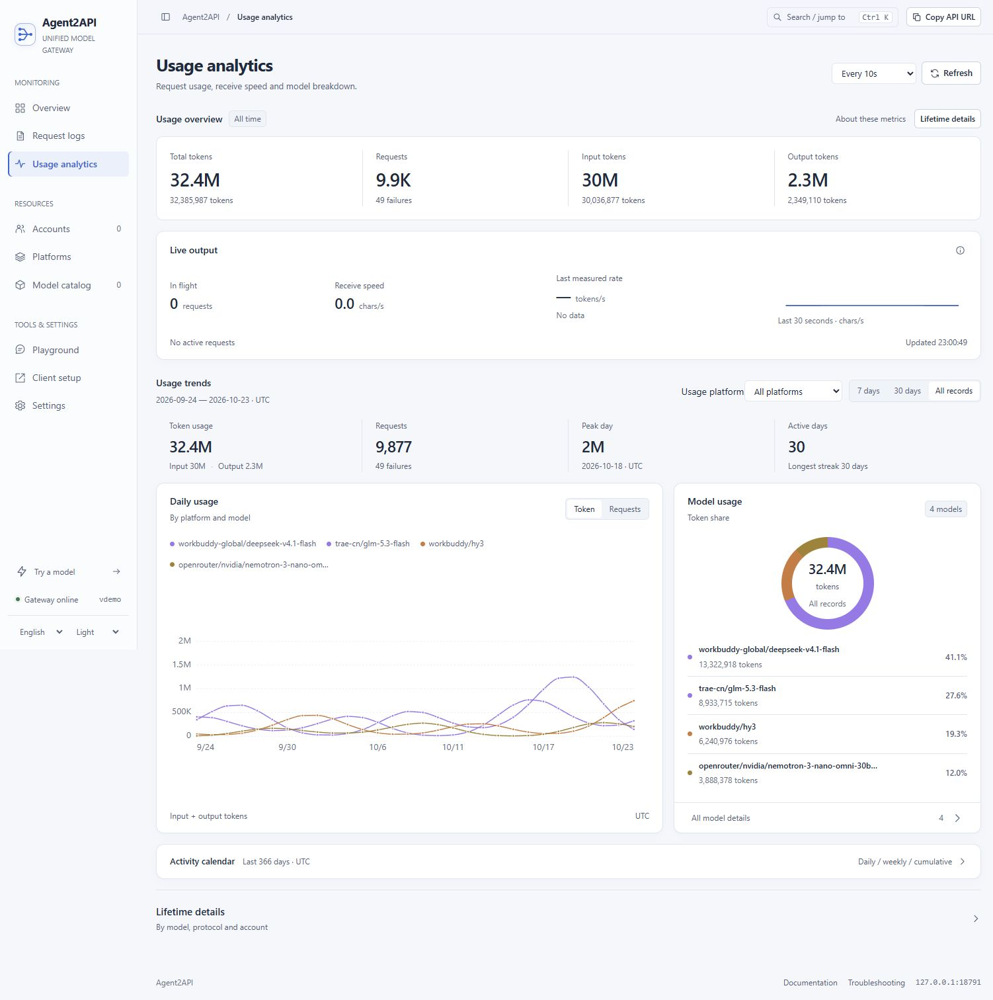

<div align="center">


# Agent2API

**Connect your models. Keep your workflow.**

<p>One local gateway. Seven platform integrations. Three standard LLM APIs.<br>Shared routing, accounts and usage for ZCode, Claude Code, Codex CLI and pi.</p>

[](https://github.com/576469377/Agent2API/actions/workflows/ci.yml) [](go.mod)

[Quick start](#quick-start) · [Console preview](#web-console) · [Platforms](#choose-an-upstream) · [Documentation](docs/README.md) · [简体中文](README.md)

</div>

## Web console

One workspace for your models, accounts, requests and usage.

<picture>
  <source media="(prefers-color-scheme: dark)" srcset="docs/assets/console-en-dark.jpg">
  
</picture>

<p align="center"><sub>Built-in console · English / Chinese · Light / dark themes · Demonstration data</sub></p>

## What it does

| Standard APIs | Visible requests | Connected clients |
|:---|:---|:---|
| Chat Completions, Responses and Anthropic Messages. Streaming, qualified model IDs, aliases and native tool calls. | Inspect uploads, queues, first output and final usage, with linked trends, cache metrics and request logs. | Configure ZCode, cc-switch and pi with verified free access, automatic backups and existing preferences preserved. |

Platform adapters share the protocol layers, routing, streaming and console. Capabilities depend on the upstream model. [Explore the architecture →](docs/architecture.md)

## Quick start

Install **Go 1.23+**, clone and start. Web assets are embedded; no frontend toolchain is required.

<details open>
<summary><b>Windows · PowerShell</b></summary>

```powershell
git clone https://github.com/576469377/Agent2API.git
cd Agent2API
go build -trimpath -o bin/agent2api.exe ./cmd/agent2api
./bin/agent2api.exe
```

</details>

<details>
<summary><b>macOS / Linux</b></summary>

```bash
git clone https://github.com/576469377/Agent2API.git
cd Agent2API
go build -trimpath -o bin/agent2api ./cmd/agent2api
./bin/agent2api
```

</details>

Open **[127.0.0.1:8787](http://127.0.0.1:8787)** → sign in under **Platforms** → copy a qualified route from **Models** → verify a response in **Playground**.

The default starts both WorkBuddy regions. For other integrations, create a local config from [config.example.json](config.example.json), keep the platforms you need and load it with `-config config.json`. [Installation and login guide →](docs/quickstart.md)

## Choose an upstream

| Platform | Authentication | Available today |
|:---|:---|:---|
| **WorkBuddy China**<br>`workbuddy` | Desktop login / console device authorization | Account pools, session affinity and per-model cooldowns |
| **WorkBuddy International**<br>`workbuddy-global` | Desktop login / console device authorization | Separate regional pool; encrypted desktop credentials verified on Windows |
| **OpenRouter**<br>`openrouter` | Your own `OPENROUTER_API_KEY` | Live free catalogue; paid and unknown-price models rejected |
| **Cursor Free**<br>`cursor` | Cursor desktop login under the same OS user | Composer 2.5; personal Free entitlement checked before generation |
| **TRAE China**<br>`trae-cn` | Official browser authorization | Verified Free monthly and check-in credits; text, reasoning and client tools |
| **Kiro Free**<br>`kiro` | Official CLI web sign-in | Personal Free monthly credits, account-selectable models and client tools |
| **Kilo Free**<br>`kilo` | Official anonymous free access; no key | Concrete free models, per-generation catalogue checks, three APIs and client tools |

Automatic client setup and model tests select currently confirmed free models. Raw WorkBuddy API requests follow account permissions. Capabilities and allowances remain platform-specific. See [platform support](docs/platforms.md), the [TRAE guide](docs/trae.md) and the [Kiro guide](docs/kiro.md).

## Client connections

Clients use gateway port **8787**. **Client setup** can configure **ZCode / cc-switch / pi**. cc-switch supports both Claude Code and Codex. Writes create backups and preserve other providers and defaults.

| Client / protocol | Endpoint |
|:---|:---|
| Chat Completions | `http://127.0.0.1:8787/v1` |
| Responses | `POST http://127.0.0.1:8787/v1/responses` |
| Claude Code | `ANTHROPIC_BASE_URL=http://127.0.0.1:8787` |
| ZCode · Anthropic Messages | Base URL: `http://127.0.0.1:8787/v1` |

Copy the full `platform/model` route from the catalogue. Without a gateway key, use `agent2api-local` if a client requires an API key; otherwise supply the configured gateway key. Keep default content sanitization enabled. [Client configuration and request examples →](docs/clients.md)

<details>
<summary><b>ZCode command-line sync</b></summary>

With the gateway running, preview and then apply confirmed free models:

```powershell
Copy-Item config.example.json config.json  # First setup only; preserve an existing config
python scripts/sync-zcode.py --config config.json --dry-run
python scripts/sync-zcode.py --config config.json
```

Retained free models keep ordering, enabled state and capability preferences. Paid, dynamic and unknown-price entries are removed. See [backups and recovery](docs/clients.md#恢复).

</details>

## Models and routing

`workbuddy/model` pins China; `workbuddy-global/model` pins International. Other integrations use the same `platform/model` format. Bare names follow platform configuration order; aliases can map to real models and pin a platform.

Optional same-name fallback happens only before stream acceptance and is off by default. Qualified routes keep their platform. Model catalogue support, scheduling readiness and quota are shown separately. [Routing and request budgets →](docs/configuration.md)

## Documentation

Detailed guides are currently in Chinese; commands, fields and examples work in either language.

| Get started | Operate | Go deeper |
|:---|:---|:---|
| [Install and make a first call](docs/quickstart.md) | [Console and standalone preview](docs/console.md) | [API reference](docs/api.md) |
| [Platform capabilities](docs/platforms.md) | [Balances and daily check-in](docs/account-benefits.md) | [Configuration and routing](docs/configuration.md) |
| [Client setup](docs/clients.md) | [Upgrade, backup and recovery](docs/operations.md) | [Tokens, cache and live metrics](docs/metrics.md) |
| [TRAE](docs/trae.md) · [Kiro](docs/kiro.md) · [Kilo](docs/kilo.md) | [Troubleshooting](docs/troubleshooting.md) | [Repository guide](docs/development.md) · [Architecture](docs/architecture.md) |

[All documentation →](docs/README.md) · [Changelog](CHANGELOG.md) · [Protocol and platform research](docs/research/README.md)

<details>
<summary><b>More runtime and development details</b></summary>

### Standalone console

Load updated UI assets from disk without restarting a gateway in use or changing client URLs. The standalone console defaults to **8788**; clients continue using **8787**. [Console guide](docs/console.md#不重启正在运行的网关).

### Configuration and accounts

The [configuration reference](docs/configuration.md) covers CLI flags, environment variables, JSON, concurrency and Prometheus. WorkBuddy regions have separate pools with health-based scheduling, affinity and model cooldowns. Other integrations use their own authentication. See [account management](docs/accounts.md).

### Credits and check-in

The account page displays the balances supplied by each upstream, preserving its units. WorkBuddy and TRAE check daily sign-in at 09:00 Beijing time by default; the gateway can do this with the web page closed. See [balances and check-in](docs/account-benefits.md).

### APIs and architecture

Generation endpoints are `/v1/chat/completions`, `/v1/responses` and `/v1/messages`, with `/v1/models`, `/health` and `/metrics` alongside them. Responses preserves Codex MCP tool namespaces and continuation links. See the [API reference](docs/api.md).

Protocol codecs share an IR with platform adapters. The Hub handles routing, WorkBuddy uses separate regional pools, and OpenRouter, Cursor, TRAE and Kiro each use their own authentication. See [architecture](docs/architecture.md).

### Testing

```bash
go test ./...
go vet ./...
node --test scripts/test-console-*.mjs
python -m unittest discover -s scripts -p 'test_*.py'
python scripts/check-docs.py
```

Tests use offline fixtures and mock services, without consuming real model quota. Ordinary builds need neither Node.js nor Python. Frontend tests need Node.js; scripts need Python 3.9+. Cursor credential reading on macOS / Linux needs Python 3. See [Contributing](CONTRIBUTING.md) for race detection.

</details>

## Known Limitations

- Private upstream protocols may change. Models and quota depend on the platform and account; three standard APIs do not imply identical upstream capabilities.
- The gateway implements compatible generation endpoints and aggregates streams for non-streaming responses, rather than the full OpenAI / Anthropic product APIs.
- Cooldowns, affinity and concurrency slots are process-local; instances do not share them.
- International encrypted desktop credentials have only been verified end to end on Windows.
- Cursor, TRAE and Kiro retain native Agent, parameter and tool boundaries. Some upstreams do not return token usage or output ceilings. See [platform support](docs/platforms.md).
- Reasoning has no upstream signature; text-mode DSML tool-call fallback is not implemented.

## Roadmap

- [x] Seven platforms, three APIs and a shared console
- [x] Incremental ZCode / cc-switch / pi configuration and backups
- [x] Account balances, daily check-in, request logs and usage analytics
- [ ] More verified platforms and allowance sources
- [ ] macOS / Linux verification of international encrypted credentials
- [ ] Per-key usage and shared scheduling state

## Security

The default listener is `127.0.0.1`. Do not publish local configuration, credentials, client files or runtime metrics. Expanded network access needs a gateway key and access controls. Remove keys, account identities and upstream request IDs from reports. See [SECURITY.md](SECURITY.md).

## Contributing

[Issues](https://github.com/576469377/Agent2API/issues) and PRs are welcome. Read [CONTRIBUTING.md](CONTRIBUTING.md) first. Report vulnerabilities privately through the [security policy](SECURITY.md).

## License

**TBD**. The repository ships no LICENSE file; all rights are reserved by default. Do not use commercially or redistribute until a license is chosen.

This is a personal learning and research project for your own authorized accounts, on your machine or a controlled private environment. Upstream terms and the complete scope are described in the [disclaimer](DISCLAIMER.md).

---

<p align="center"><a href="#quick-start">Get started</a> · <a href="docs/README.md">Read the docs</a> · <a href="CHANGELOG.md">See what's new</a></p>
