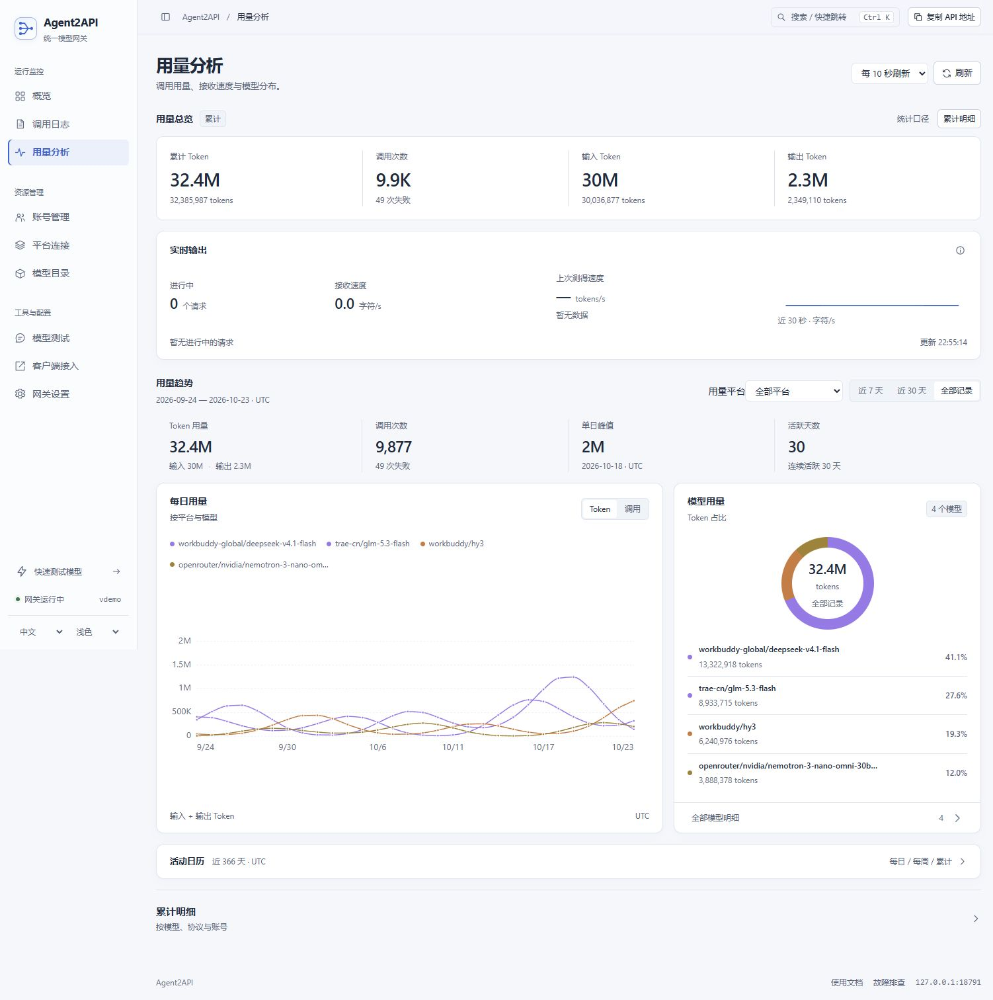

<div align="center">


# Agent2API

**连接你的模型，专注你的工作流。**

<p>一个本地入口，连接六个平台，提供三种标准 LLM API。<br>让 ZCode、Claude Code、Codex CLI 与 pi 共用模型路由、账号和用量控制台。</p>

[](https://github.com/576469377/Agent2API/actions/workflows/ci.yml) [](go.mod)

[快速开始](#快速开始) · [控制台预览](#网页控制台) · [平台支持](#选择上游平台) · [文档中心](docs/README.md) · [English](README.en.md)

</div>

## 网页控制台

从一次调用到整个工作空间，把模型、账号、日志和用量放在一起。

<picture>
  <source media="(prefers-color-scheme: dark)" srcset="docs/assets/console-dark.jpg">
  
</picture>

<p align="center"><sub>内置网页控制台 · 中英文 · 深浅主题 · 图中为演示数据</sub></p>

## 它解决什么问题

| 统一 API | 看清每次调用 | 配好你的客户端 |
|:---|:---|:---|
| Chat Completions、Responses、Anthropic Messages。流式回复、模型前缀、别名与原生工具调用。 | 从上传、排队、首段输出到完成用量，联动查看趋势、缓存与调用日志。 | 一键配置 ZCode、cc-switch 和 pi，核验免费权益、备份并保留已有设置。 |

平台适配器与协议层分离；新增上游可复用路由、流式转换和控制台。模型能力以各平台目录为准。[了解架构 →](docs/architecture.md)

## 快速开始

准备 **Go 1.23+**，克隆并启动。网页资源随程序嵌入，无需安装前端工具链。

<details open>
<summary><b>Windows · PowerShell</b></summary>

```powershell
git clone https://github.com/576469377/Agent2API.git
cd Agent2API
go build -trimpath -o bin/agent2api.exe ./cmd/agent2api
./bin/agent2api.exe
```

</details>

<details>
<summary><b>macOS / Linux</b></summary>

```bash
git clone https://github.com/576469377/Agent2API.git
cd Agent2API
go build -trimpath -o bin/agent2api ./cmd/agent2api
./bin/agent2api
```

</details>

打开 **[127.0.0.1:8787](http://127.0.0.1:8787)** → **平台连接**完成登录 → 在**模型目录**复制完整路由 → **模型测试**验证一次回复。

默认启动 WorkBuddy 国内版与国际版。启用其他平台时，从 [config.example.json](config.example.json) 创建本地配置，保留需要的平台，再用 `-config config.json` 显式加载。[完整安装与登录指南 →](docs/quickstart.md)

## 选择上游平台

| 平台 | 登录与接入 | 当前支持 |
|:---|:---|:---|
| **WorkBuddy 国内版**<br>`workbuddy` | 桌面登录态 / 控制台设备登录 | 多账号调度、会话亲和、按模型冷却 |
| **WorkBuddy 国际版**<br>`workbuddy-global` | 桌面登录态 / 控制台设备登录 | 独立区域与账号池；加密桌面凭证已在 Windows 验证 |
| **OpenRouter**<br>`openrouter` | 自己的 `OPENROUTER_API_KEY` | 动态免费目录，拒绝收费与价格未知的模型 |
| **Cursor Free**<br>`cursor` | 同一系统用户的 Cursor 桌面登录态 | Composer 2.5；生成前核验个人 Free 权益 |
| **TRAE 国内版**<br>`trae-cn` | 官方网页登录 | Free 月赠与已确认签到积分；文本、思考与客户端工具 |
| **Kiro Free**<br>`kiro` | 官方 CLI 网页登录 | 个人 Free 月度积分、账号自选模型与客户端工具 |

客户端自动配置和模型测试选择当前确认免费的模型；WorkBuddy 原始 API 按账号权限受理手工请求。不同平台的能力和额度各自独立，详见[平台支持](docs/platforms.md)、[TRAE 指南](docs/trae.md)与 [Kiro 指南](docs/kiro.md)。

## 接入客户端

客户端连接网关端口 **8787**。在控制台的**客户端接入**页，可一键配置 **ZCode / cc-switch / pi**；cc-switch 同时支持 Claude Code 与 Codex，写入前自动备份，保留其他供应商和默认选择。

| 客户端 / 协议 | 接入地址 |
|:---|:---|
| Chat Completions | `http://127.0.0.1:8787/v1` |
| Responses | `POST http://127.0.0.1:8787/v1/responses` |
| Claude Code | `ANTHROPIC_BASE_URL=http://127.0.0.1:8787` |
| ZCode · Anthropic Messages | Base URL：`http://127.0.0.1:8787/v1` |

从模型目录复制 `平台/模型` 完整路由。未配置网关密钥时，客户端必填的 API Key 可用 `agent2api-local`；已配置则填写对应网关密钥。保持默认内容脱敏设置。[客户端配置与请求示例 →](docs/clients.md)

<details>
<summary><b>ZCode 命令行同步</b></summary>

网关启动后，先预览，再应用已确认免费的模型配置：

```powershell
Copy-Item config.example.json config.json  # 仅首次创建；保留已有配置
python scripts/sync-zcode.py --config config.json --dry-run
python scripts/sync-zcode.py --config config.json
```

保留免费模型的排序、启用状态与能力设置；移除付费、浮动及价格未知的旧条目。[备份与恢复](docs/clients.md#恢复)。

</details>

## 模型与路由

`workbuddy/模型名` 固定国内版，`workbuddy-global/模型名` 固定国际版；其他平台同样使用 `平台/模型`。裸名按平台配置顺序选择，别名可映射到真实模型并固定平台。

可选的同名回退只发生在建流前，默认关闭；显式平台路由保持其平台。模型目录、账号可调度与剩余额度分别展示。[路由与请求预算 →](docs/configuration.md)

## 文档

| 开始使用 | 日常管理 | 深入了解 |
|:---|:---|:---|
| [安装与首次调用](docs/quickstart.md) | [控制台与独立预览](docs/console.md) | [API 参考](docs/api.md) |
| [平台与能力](docs/platforms.md) | [账号、余额与签到](docs/account-benefits.md) | [配置与模型路由](docs/configuration.md) |
| [客户端配置](docs/clients.md) | [升级、备份与恢复](docs/operations.md) | [Token、缓存与实时指标](docs/metrics.md) |
| [TRAE](docs/trae.md) · [Kiro](docs/kiro.md) | [错误与登录排查](docs/troubleshooting.md) | [开发导览](docs/development.md) · [当前架构](docs/architecture.md) |

[全部文档 →](docs/README.md) · [更新日志](CHANGELOG.md) · [协议与平台调研](docs/research/README.md)

<details>
<summary><b>更多运行与开发细节</b></summary>

### 独立控制台

已有网关正在使用时，可从磁盘加载新版界面，无需重启网关或修改客户端地址。独立控制台默认端口 **8788**，客户端仍使用 **8787**。[使用说明](docs/console.md#不重启正在运行的网关)。

### 配置与多账号

[配置参考](docs/configuration.md)覆盖 CLI、环境变量、JSON、并发和 Prometheus。WorkBuddy 两个区域分别管理账号池，支持健康调度、会话亲和与按模型冷却；其他平台使用自己的认证。[账号与调度](docs/accounts.md)。

### 积分与签到

账号页集中展示上游提供的积分或余额，单位按平台保留。WorkBuddy 与 TRAE 默认每天北京时间 09:00 自动检查签到，网页关闭后仍可运行。[余额与签到说明](docs/account-benefits.md)。

### 接口与架构

生成端点为 `/v1/chat/completions`、`/v1/responses`、`/v1/messages`，另提供 `/v1/models`、`/health` 与 `/metrics`。Responses 保留 Codex MCP 工具命名空间与续轮关联。[API 参考](docs/api.md)。

协议编解码经统一 IR 连接平台适配器，Hub 负责路由；WorkBuddy 两区使用独立号池，OpenRouter、Cursor、TRAE 与 Kiro 各自认证。[架构说明](docs/architecture.md)。

### 测试

```bash
go test ./...
go vet ./...
node --test scripts/test-console-*.mjs
python -m unittest discover -s scripts -p 'test_*.py'
python scripts/check-docs.py
```

测试使用离线样本和模拟服务，不消耗真实模型额度。普通构建无需 Node.js 或 Python；前端测试需要 Node.js，脚本需要 Python 3.9+。Cursor 在 macOS / Linux 读取登录态需要 Python 3。竞态检测见[贡献指南](CONTRIBUTING.md)。

</details>

## 已知限制

- 私有上游协议可能变化，模型与额度取决于平台和账号；三种标准协议不代表所有上游具备相同能力。
- 网关提供兼容的生成接口，非流式回复由上游流聚合，不实现完整 OpenAI / Anthropic 产品 API。
- 账号冷却、会话亲和和并发槽位为单进程状态，多实例之间不共享。
- 国际桌面加密凭证目前仅在 Windows 完成端到端验证。
- Cursor、TRAE、Kiro 的原生 Agent、参数与工具有各自边界；部分上游不返回 Token 或输出上限。详见[平台支持](docs/platforms.md)。
- 思考输出没有上游签名；文本态 DSML 工具调用兜底尚未实现。

## 路线图

- [x] 六个平台、三种协议与统一控制台
- [x] ZCode / cc-switch / pi 增量配置与备份
- [x] 账号余额、每日签到、调用日志与用量分析
- [ ] 更多可验证的平台与额度来源
- [ ] 国际桌面加密凭证的 macOS / Linux 实测
- [ ] 多密钥用量管理与共享调度状态

## 安全须知

默认仅监听 `127.0.0.1`。不要上传配置、凭证、客户端文件或运行指标；扩大监听范围时配置网关密钥与访问控制。反馈问题前移除密钥、账号身份和上游请求 ID。[安全策略](SECURITY.md)。

## 贡献

欢迎 [Issue](https://github.com/576469377/Agent2API/issues) 与 PR，请先读[贡献指南](CONTRIBUTING.md)。漏洞按[安全策略](SECURITY.md)私下报告。

## 许可证

**尚未确定（TBD）**。仓库未附 LICENSE，默认保留所有权利；确定前请勿商用或再分发。

本项目为个人学习与技术研究项目，仅供本人已授权账号在本机或受控私有环境自用；上游使用条款及完整边界见[免责声明](DISCLAIMER.md)。

---

<p align="center"><a href="#快速开始">开始使用</a> · <a href="docs/README.md">阅读文档</a> · <a href="CHANGELOG.md">查看更新</a></p>
