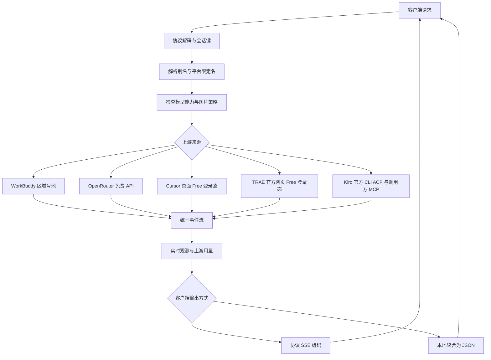

# 当前实现架构

[文档导航](README.md) · [开发导览](development.md) · [指标口径](metrics.md) · [历史架构稿](design/01-架构设计.md)

Agent2API 把多种上游服务转换为 Chat Completions、Responses 和 Anthropic Messages。核心边界是统一请求与事件 IR：下游协议不感知 WorkBuddy、OpenRouter 或 Cursor 的私有实现，上游适配器也不负责客户端协议编码。

## 运行组件

| 组件 | 入口 | 职责 |
|---|---|---|
| 网关 | `cmd/agent2api` | 平台装配、生成接口、管理 API、指标和嵌入式网页 |
| 独立控制台 | `cmd/console` | 从磁盘读取同一套静态资源，将 API / SSE 转给现有网关 |
| 平台运行时 | `internal/app/Hub` | 平台顺序、模型目录、别名和明确平台路由 |
| WorkBuddy 号池 | `internal/adapter/Pool` | 同一区域的账号、亲和、容量、模型冷却和健康度 |
| 指标 | `internal/obs` | 请求计数、实际用量、实时观测和可恢复快照 |

默认启动保留 WorkBuddy 两区入口。声明平台列表后，可同时启用 OpenRouter、Cursor 和 TRAE 国内；具体能力与认证见[平台支持](platforms.md)。

## 请求路径

`Adapter` 只有 `Stream`、`ListModels`、`Name` 三个必需方法。`ResponseStream` 用 `Recv` 提供统一事件，支持关闭的流同时实现释放接口。`api/*` 和具体 `adapter/*` 通过 `internal/llm` 通信；同一项能力通常只需分别适配上游和下游，而不为每一对组合重写转换。

## 路由与账号隔离

- `平台ID/模型ID` 固定来源；同名裸 ID 按平台配置顺序处理。别名在模型路由前解析。
- 国内与国际版分别持有凭证、模型目录、登录会话、账号池、亲和及冷却，不能混用账号文件。
- 可选同名回退只在建流前、且错误类型允许时发生；明确平台路由不会跨区。响应被接受后不再切平台。
- OpenRouter 的 API Key、Cursor 桌面权益检查、TRAE 网页 PKCE 授权与 WorkBuddy 设备登录各自实现，不用同一种凭证结构解释所有平台。
- 账号就绪只表示当前本地调度判断；目录、免费费率、账号额度和上游服务状态分别处理。

路由入口见 [hub.go](../internal/app/hub.go)、[aliases.go](../internal/app/aliases.go)和 [routing.go](../internal/app/routing.go)。

## 请求生命周期

执行记录贯穿一次客户端请求，保存请求编号、阶段、排队耗时和尝试摘要。生成重拨、换账号及允许的平台回退共享尝试预算；凭证刷新、目录查询不计入生成次数。

本地账号容量的选号和占槽在同一锁内完成；所有候选满载时才使用有数量与时间上限的队列。流保持占槽直至完成或关闭，取消和错误不会漏掉释放。默认每账号并发仍为零，即不限，不会无条件排队。

建流预算覆盖选路、排队、图片上传和等待接受响应，成功后停止对应计时，不截断已接受的长流。WorkBuddy 不将非流式 60 秒超时套用于流式上传。生成期间仍受空闲和总时长控制，具体默认值见[配置](configuration.md#请求预算和等待队列gateway)。

HTTP 观察放在 [http_trace.go](../internal/adapter/http_trace.go)，只更新上传 / 等待响应阶段，不修改请求、连接复用或计时策略。迟到回调不能把已经开始接收的双向流改回上传状态。

## 失败与流

`llm.Failure` 保留原始业务码、类型、取消原因及可重试性质。号池依据已有信息处理鉴权、模型额度、限流、传输和参数错误，不从模糊文本推断账号封禁。

本地队列或尝试预算用尽不降低上游账号健康度。收到真实限流恢复时刻时，按账号和模型冷却；没有恢复依据时不能凭空把免费模型锁定很久。

上游首事件探测覆盖“HTTP 200、首个事件就拒绝”的情况。响应一旦开始，不自动重放；中途错误用协议对应的流内事件返回，并在最终请求记录中保留失败，避免只看 HTTP 200 误判成功。

## 指标与文件

指标包含四种不同的范围：累计计数、UTC 日期汇总、最近 200 条完成样本和当前实时请求。快照存储状态由 `internal/app/metrics_storage.go` 管理，周期保存；正常关闭先等待请求收尾，再保存最终指标。

历史导入不会把交集未知的累计文件直接相加。旧数据缺少日期时保留缺口；浏览器的历史均摊是派生视图，计算来源在“统计口径”中查看，不重写原始快照。定义见[指标口径](metrics.md)，文件维护见[运行与升级](operations.md)。

## 控制台

控制台使用原生 ES 模块和共享 CSS 变量，通过 `go:embed` 发布。`app.js` 协调页面与事件，指标计算、价格判断、资源加载和用量视图分散在独立模块。新增样本概览和诊断摘要位于 `insights.js`。

资源各自完成后即可展示，不让慢模型目录阻塞本地统计。刷新保留筛选、焦点、表格滚动和展开状态；实时数据过期与费率未知显示对应状态，历史用量的计算说明集中在“统计口径”。年度日历按需渲染，不在主趋势前占用大量空间。

## 新增平台

1. 在 `internal/adapter/` 实现认证、模型目录和生成事件转换，不把私有逻辑写入下游协议层。
2. 在启动装配、合法平台列表及默认地址 / 凭证位置中注册，建立独立运行时。
3. 声明能力与认证方式。需要多账号或设备登录时单独实现，不能默认套用 WorkBuddy 结构。
4. 补齐价格、免费策略、错误分类、工具、图片与思考的实际支持范围。
5. 通过脱敏金帧、IR 断言和适当的集成验证，再更新[平台支持](platforms.md)、[配置](configuration.md)和[开发导览](development.md)。

新增能力可能要求扩展 IR 或编码器。架构允许扩展不等于尚未实现的平台已经可以调用。
