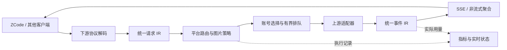

# 开发与仓库导览

[文档导航](README.md) · [当前架构](architecture.md) · [贡献指南](../CONTRIBUTING.md) · [本轮全仓审查](reviews/2026-10-24-project-optimization-review.md)

先读请求路径，再选择需要修改的层。网关不要求前端打包器或数据库，Go 静态嵌入控制台；测试和维护脚本按需要使用 Node.js 与 Python。

## 仓库地图

| 位置 | 责任 | 建议起点 |
|---|---|---|
| `cmd/agent2api` | CLI、平台装配、目录监视、保活与关闭流程 | [main.go](../cmd/agent2api/main.go)、[accounts.go](../cmd/agent2api/accounts.go) |
| `cmd/console` | 不重启网关的磁盘控制台与 API 代理 | [main.go](../cmd/console/main.go) |
| `internal/llm` | 请求、事件、用量、失败分类与执行记录 | [types.go](../internal/llm/types.go)、[failure.go](../internal/llm/failure.go)、[execution.go](../internal/llm/execution.go) |
| `internal/adapter` | 适配器契约、号池、亲和、排队与传输观察 | [adapter.go](../internal/adapter/adapter.go)、[pool.go](../internal/adapter/pool.go)、[queue.go](../internal/adapter/queue.go) |
| `internal/adapter/workbuddy` | 两区认证、会话标识、请求和 SSE | [adapter.go](../internal/adapter/workbuddy/adapter.go)、[conversation.go](../internal/adapter/workbuddy/conversation.go) |
| `internal/adapter/openrouter` | 免费目录、零价格路由与官方 API | [adapter.go](../internal/adapter/openrouter/adapter.go) |
| `internal/adapter/cursor` | 桌面登录态、Free 权益、HTTP/2 Connect 与客户端工具 | [adapter.go](../internal/adapter/cursor/adapter.go) |
| `internal/adapter/trae` | 官方网页授权、Free 积分来源、原生消息与 SSE | [adapter.go](../internal/adapter/trae/adapter.go)、[protocol_test.go](../internal/adapter/trae/protocol_test.go) |
| `internal/adapter/kiro` | 官方 CLI ACP、模型目录与调用方 MCP | [adapter.go](../internal/adapter/kiro/adapter.go)、[runtime.go](../internal/adapter/kiro/runtime.go) |
| `internal/clientconfig`、`internal/zcode` | 免费模型筛选、客户端增量合并、备份及并发写入校验 | [models.go](../internal/clientconfig/models.go)、[files.go](../internal/clientconfig/files.go)、[store.go](../internal/zcode/store.go) |
| `internal/api` | Chat、Responses、Messages 的请求与输出转换 | [protocols.go](../internal/app/protocols.go)中的装配入口 |
| `internal/app` | HTTP、Hub 路由、图片策略、管理 API 和指标协调 | [app.go](../internal/app/app.go)、[routing.go](../internal/app/routing.go)、[api.go](../internal/app/api.go) |
| `internal/obs` | 累计量、实时窗口、历史日期和快照导入 | [metrics.go](../internal/obs/metrics.go)、[live.go](../internal/obs/live.go)、[history.go](../internal/obs/history.go) |
| `internal/config` | 默认值、平台继承与配置验证 | [config.go](../internal/config/config.go) |
| `internal/web` | 嵌入式资源和原生 ES 模块控制台 | [web.go](../internal/web/web.go)、[app.js](../internal/web/static/app.js) |
| `scripts` | ZCode 同步、只读诊断、凭证和文档检查 | [贡献指南](../CONTRIBUTING.md#构建与测试) |
| `fixtures` | 已脱敏的上游事件样本 | [样本说明](../fixtures/README.md) |
| `docs/research`、`docs/design`、`docs/reviews` | 日期明确的证据、历史方案和审查结果 | 日常配置以当前指南为准 |

## 一次请求经过哪里

OpenRouter、Cursor 与 TRAE 使用各自认证逻辑，不经过 WorkBuddy 的号池与设备登录。错误在仍有类型信息的地方转换为 `llm.Failure`；不要把业务码压成自由文本后再依靠页面正则判断原因。

## 控制台模块

| 文件 | 维护边界 |
|---|---|
| `app.js` | 页面装配、资源状态、事件处理和抽屉；仍是较大的协调模块 |
| `core.js`、`math.js` | 转义、SSE 读取、格式化、Markdown 与数学展示 |
| `resources.js` | 页面资源依赖、独立加载、目录与账号可用性 |
| `pricing.js` | 费率来源、过期判断、变化提示和确认免费模型筛选 |
| `monitor.js`、`insights.js` | 请求筛选、结果分类、样本分位数、缓存比例和诊断摘要 |
| `dashboard.js` | 累计 / 分钟窗口聚合及账号就绪判断 |
| `usage.js`、`usage-allocation.js` | UTC 日期、曲线、实时校准与可撤销的历史派生视图 |
| `usage-view.js` | 用量和实时视图；只接收已整理的数据 |
| `operations.js` | 操作状态与已有事实的诊断提示 |

优先将可独立验证的数据变换放进小模块，不将所有判断继续追加进 `app.js`。现阶段保留原生 ES 模块和共享样式变量；新增视图没有引入 React、图表 SDK、外部字体或统计服务。

## 需要保持的不变量

1. **三协议共用上游能力。** `api/*` 不直接依赖具体平台适配器，通过 `llm` 交换请求和事件。
2. **一次逻辑请求共享预算。** 重拨、换号和平台回退不能各自重新获得完整尝试次数；目录查询和刷新不消耗生成次数。
3. **完整流不能重放。** 选路仅在建流前回退。已开始响应的错误交给客户端处理，不自动换号复制半段回答。
4. **超时必须按阶段。** 上传、等待首段和回答接收不同。观测回调不改变计时器；WorkBuddy 流式上传不得重新套用非流式 60 秒超时。
5. **容量必须成对释放。** 选号与占槽原子完成；取消、建流失败、用尽和关闭只释放一次。更改并发上限不能让旧租约释放到新信号量。
6. **未知不能变成实测零。** 旧字段缺失、没有最终用量、无有效分位数样本和过期实时数据分别处理。
7. **区域与模型身份不能混淆。** 同名模型分平台统计；免费目录和账号就绪不等于还有额度。客户端配置与模型测试只使用确认免费的明确平台路由。
8. **隐私数据留在本机。** 诊断摘要使用允许字段列表，不导出凭证、正文、账号标识或文件路径；金帧只使用脱敏样本。

## 按变更选择验证

| 变更 | 最小相关验证 | 补充验证 |
|---|---|---|
| 下游协议 / 上游 SSE | 对应包金帧与 IR 事件断言 | 三协议集成测试、必要的真实免费调用 |
| 号池 / 队列 / 取消 | `internal/adapter`、`internal/app` 测试 | CI 竞态检查、容量与健康状态不变量 |
| 费率 / 免费路由 | 定价、OpenRouter、Cursor 及 ZCode 测试 | 确认过期、未知或付费状态都不会成为免费 |
| 指标 | `internal/obs` 与实时集成测试 | 乱序完成、持久化恢复、缺失字段与分钟边界 |
| 控制台计算 | 对应 `test-console-*.mjs` | 浏览器核对显示、筛选联动、深浅主题和小屏 |
| 文档 / 导航 | `check-docs.py` 与对应测试 | 示例命令、默认值、相对路径与当前代码交叉核对 |

完整本地命令见[贡献指南](../CONTRIBUTING.md#构建与测试)。CI 在 Linux / macOS 检查 Go 1.23 与 stable 并执行竞态检测，Windows stable 执行构建、静态检查与测试；桌面凭证与真实上游仍需单独实机验证。

## 本地调试与提交

- 前端使用[独立控制台](operations.md#只更新控制台界面)，避免为了改页面中断生成。
- 后端候选构建写入新的 `bin/` 文件，在独立端口验证；使用独立统计路径，不能两个进程共写生产快照。
- 有真实请求时，不覆盖正在运行的程序。发布步骤见[运行与升级](operations.md#更新网关)。
- 配置、凭证、客户端文件、日志与 `bin/` 都属于本地资料；不要强制加入 Git。
- 现有工作集中到 `main`；提交应说明用户遇到的具体问题、最终行为与验证范围，保留真实限制。

已实施改进、基准和后续优先级见[全仓审查](reviews/2026-10-24-project-optimization-review.md)。

客户端快捷配置由 `internal/clientconfig/` 统一筛选已核验免费模型，并处理 pi JSON、cc-switch SQLite / Codex TOML；`internal/zcode/` 复用同一筛选规则。管理端点位于 `internal/app/clients.go`，交互与批量结果位于 `internal/web/static/client-setup.js`。新增客户端须覆盖配置保留、并发修改拒绝、重复同步不写入、备份和本机访问约束。
